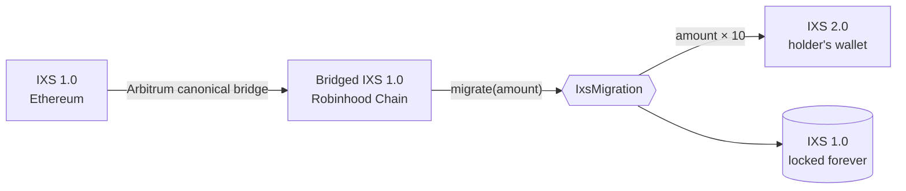

# IXS Contracts

Smart contract source for IXS, published for auditors, reviewers and integrators.

Tests and deployment scripts live in [IXS-Finance/ixs-vaults-uups](https://github.com/IXS-Finance/ixs-vaults-uups). That repository is private; access is available on request.

## `IxsToken`

[`contracts/IxsToken.sol`](contracts/IxsToken.sol): the IXS 2.0 ERC-20 token. **Not deployed yet.**

- 2.5B IXS are minted once, in the constructor, to `genesis`. No mint function exists.
- Holders can `burn` their own tokens, or `burnFrom` with an allowance.
- The owner (`Ownable2Step`) can only `pause`/`unpause`, which halts all transfers and burns. It cannot mint, move, seize or blacklist tokens.
- Pausing also stops `IxsMigration`, whose payouts are IXS 2.0 transfers.
- `renounceOwnership` is blocked while paused.
- Not upgradeable. No permit.

**Scope:** one file, 57 lines. It is built from stock OpenZeppelin v5.3.0 components (`ERC20`, `ERC20Burnable`, `ERC20Pausable`, `Ownable2Step`). The only custom logic is the `renounceOwnership` guard.

## `IxsMigration`

[`contracts/IxsMigration.sol`](contracts/IxsMigration.sol): a one-way swap from IXS 1.0 to IXS 2.0 on Robinhood Chain, at **1 IXS 1.0 → 10 IXS 2.0**. **Not deployed yet.**

How it works:
1. Bridge IXS 1.0 from Ethereum to Robinhood Chain over the [Arbitrum canonical bridge](https://portal.arbitrum.io/bridge?sourceChain=ethereum&destinationChain=robinhood-chain).
2. On Robinhood Chain, `approve` the migration contract, then call `migrate(amount)`.
3. In the same transaction, the contract takes `amount` IXS 1.0 and sends `amount × 10` IXS 2.0 to the caller.

Design:
- **Canonical IXS 1.0 only.** The accepted token is fixed at deployment. Any other token named "IXS" is never touched.
- **Exact and atomic.** 1 → 10 with no fees and no rounding. Both legs settle in one transaction or the whole transaction reverts. If the contract holds too little IXS 2.0, `migrate` reverts and the holder keeps their IXS 1.0.
- **Checked at deployment.** The constructor reverts `DecimalsMismatch` unless both tokens report the same `decimals()` (both are 18), and requires IXS 2.0 to expose `paused()`.
- **Stops while IXS 2.0 is paused.** Pausing `IxsToken` also stops `migrate`. `paused()` on this contract does not show that; `availableToMigrate()` returns 0 while either contract is paused, so frontends should gate on it.
- **Pays the caller.** IXS 2.0 always goes to the address that calls `migrate`. For a multisig or smart wallet, that is the multisig or wallet itself.
- **Pre-funded, never mints.** IXS funds the contract with IXS 2.0 by plain transfer.
- **Migrated IXS 1.0 is locked forever.** No function can move it. The only IXS 1.0 that can be swept is IXS 1.0 sent to the contract directly by mistake, meaning any balance above `totalMigrated`.
- **Owner (`Ownable2Step`)** can:
  - pause and unpause `migrate`;
  - sweep IXS 2.0 and stray tokens.

  It cannot move migrated IXS 1.0, change the ratio or the tokens, mint, or take tokens from holders. `renounceOwnership` is blocked while paused, so the contract can never be left paused with no owner. To close the migration: sweep the remaining IXS 2.0, then renounce.
- **Not upgradeable.**

**Scope:** one file, 137 lines. It is built from stock OpenZeppelin v5.3.0 components (`Ownable2Step`, `Pausable`, `SafeERC20`).

### Canonical IXS

| Token / contract | Chain | Address |
|---|---|---|
| IXS 1.0 (canonical) | Ethereum (1) | [`0x73d7c860998CA3c01Ce8c808F5577d94d545d1b4`](https://etherscan.io/token/0x73d7c860998CA3c01Ce8c808F5577d94d545d1b4) |
| Arbitrum L1 ERC-20 gateway (bridge escrow) | Ethereum (1) | [`0x85001CC4867C5e1C22dA4B79BB8852B9e2a06da0`](https://etherscan.io/address/0x85001CC4867C5e1C22dA4B79BB8852B9e2a06da0) |
| IXS 1.0 (bridged, canonical) | Robinhood Chain (4663) | [`0x91d5d2C999C35ce061fD4967e6764Cdd9cF1b3e1`](https://robinhoodchain.blockscout.com/token/0x91d5d2C999C35ce061fD4967e6764Cdd9cF1b3e1) |
| Arbitrum L2 ERC-20 gateway | Robinhood Chain (4663) | [`0xfd9b17206278C16DdaacF6AC8f05dBf97EdCb31e`](https://robinhoodchain.blockscout.com/address/0xfd9b17206278C16DdaacF6AC8f05dBf97EdCb31e) |
| IXS 2.0 (`IxsToken`) | Robinhood Chain (4663) | Not deployed |
| `IxsMigration` | Robinhood Chain (4663) | Not deployed |

The bridged IXS 1.0 is the token that the Arbitrum gateway issues for canonical IXS. Anyone can check this on-chain:
- `l1Address()` on the bridged token returns the Ethereum IXS address;
- `calculateL2TokenAddress(0x73d7…d1b4)` on the L2 gateway returns the bridged token.

The bridged token's code is upgradeable by Robinhood Chain's bridge governance, as with every Arbitrum standard-bridged token. IXS cannot upgrade it.

## Contracts

| Contract | What it is | Upgradeable | Status |
|---|---|---|---|
| [`IxsToken`](contracts/IxsToken.sol) | IXS 2.0 ERC-20, fixed 2.5B supply | No | Not deployed |
| [`IxsMigration`](contracts/IxsMigration.sol) | IXS 1.0 → IXS 2.0 swap, 1:10, one-way | No | Not deployed |
| [`ERC7540OperatedVault`](contracts/ERC7540OperatedVault.sol) | ERC-4626 vault with ERC-7540-style async requests and operator push settlement (not ERC-7540 compliant) | UUPS | Live |
| [`ManagedVault`](contracts/ManagedVault.sol) | ERC-4626 vault with sync deposits and queued redemptions | UUPS | Live |

## Vault deployments

| Vault | Chain | Asset | Contract | Proxy | Implementation |
|---|---|---|---|---|---|
| IX High Yield Bond (USDC), permissionless | Avalanche (43114) | USDC | `ERC7540OperatedVault` | [`0xaD01573b459805E3954398796203d830B57A8bD9`](https://snowscan.xyz/address/0xaD01573b459805E3954398796203d830B57A8bD9) | [`0x648c66E8791B1Ea20f01db549b49dE7FBa3f2a53`](https://snowscan.xyz/address/0x648c66E8791B1Ea20f01db549b49dE7FBa3f2a53) ² |
| IX High Yield Bond (USDC), permissioned | Avalanche (43114) | USDC | `ERC7540OperatedVault` | [`0x864E9C192a724773C2bB8C1e84572996074F0B41`](https://snowscan.xyz/address/0x864E9C192a724773C2bB8C1e84572996074F0B41) | [`0x35F8C1ea3b3Be06E5626F057094E498338f7B821`](https://snowscan.xyz/address/0x35F8C1ea3b3Be06E5626F057094E498338f7B821) ² |
| IX High Yield Bond (USDG) | Robinhood Chain (4663) | USDG | `ERC7540OperatedVault` | [`0x4a8B74A9d246082b671540492222e89c9A866498`](https://robinhoodchain.blockscout.com/address/0x4a8B74A9d246082b671540492222e89c9A866498) | [`0xbBCa80A7116aE46b0F249D279Ef43F86274dc4F4`](https://robinhoodchain.blockscout.com/address/0xbBCa80A7116aE46b0F249D279Ef43F86274dc4F4) ² |
| ix7540v1 | Base (8453) | USDC | `ERC7540OperatedVault` | [`0x864E9C192a724773C2bB8C1e84572996074F0B41`](https://basescan.org/address/0x864E9C192a724773C2bB8C1e84572996074F0B41) | [`0x35F8C1ea3b3Be06E5626F057094E498338f7B821`](https://basescan.org/address/0x35F8C1ea3b3Be06E5626F057094E498338f7B821) ² |
| ixv1 | BNB Chain (56) | USDC (18 dec) | `ManagedVault` | [`0xc975a3EeF2e49F8eDdEf585340C43f15300fCB82`](https://bscscan.com/address/0xc975a3EeF2e49F8eDdEf585340C43f15300fCB82) | [`0x96D16f6A266fa90702aA3E579aB87F983cEe9FF0`](https://bscscan.com/address/0x96D16f6A266fa90702aA3E579aB87F983cEe9FF0) ¹ |

- Some addresses repeat across chains because the same deployer and nonce were used. Always pair an address with its chain.
- ¹ Deployed from an earlier revision of `ManagedVault`, so its bytecode does not match the source here.
- ² Deployed before `requestDepositWithReferral` and the Zokyo v1 fixes were added, and built with solc 0.8.28, so their bytecode does not match the source here until upgraded.

## Vaults

Both vaults issue 18-decimal shares against an asset held off-chain by a custodian. Deposits are forwarded to `custody` immediately. Custody funds the vault before a redemption is finalized.

**`ERC7540OperatedVault`**
- Deposit: `requestDeposit`, then the operator calls `finalizeDepositRequest(id, executionPrice)` to mint shares, or `rejectDepositRequest` to refund.
- Referral: `requestDepositWithReferral(assets, controller, owner, referralCode)` is `requestDeposit` plus a nonzero `bytes32` introducer code, emitted in `DepositReferral(requestId, controller, referralCode)`. No storage, no on-chain validation. The standard `requestDeposit` is unchanged.
- Redeem: `requestRedeem` escrows shares, then the operator calls `finalizeRedeemRequest(id, executionPrice)` to pay out, or `rejectRedeemRequest` to return the shares.
- Settlement uses the execution price only. The first price must come from `setNAV`: both finalize functions revert `NavNotInitialized` until one exists. After that, `setNAV` is a manual override and never prices a settlement.
- `pricePerShare` is indicative: the last settled or manually set price. It can be stale, and can move backwards when an older request settles after a newer one. `totalAssets`, `convertTo*` and the fee-inclusive `preview*` functions derive from it, so they are estimates. Do not use them as a lending or liquidation oracle.
- Fees: `subscribeFeeBps` (taken in shares) and `redeemFeeBps` (taken in assets), each capped at 10% (`MAX_FEE_BPS`) and frozen per request at request time.
- **ERC-7540-style, not ERC-7540 compliant.** Settlement pushes shares or assets straight to the controller, with no Claimable state: `claimable*` views return 0, the claim overloads revert, and the sync ERC-4626 entry points are disabled. Requests are controller-only (`msg.sender == controller == owner`); `setOperator` reverts and `isOperator` is always false. `supportsInterface` advertises ERC-165, AccessControl and ERC-7575 only, not the ERC-7540 IDs. Do not route the vault through generic ERC-7540 claim tooling.
- With the whitelist on, the controller is checked at request time and again at finalize. A controller removed while a request is pending can only be rejected.
- Events: index `DepositRequestFinalized` / `RedeemRequestFinalized` (controller, gross, fee, net, execution price). The ERC-4626 `Deposit` / `Withdraw` events carry gross (pre-fee) amounts and the operator as `sender`, unchanged so the live vaults' event history stays consistent.
- Sending shares or the asset straight to the vault does not redeem them, and the vault cannot return them. Use `requestRedeem`.

**`ManagedVault`**
- Deposit: sync `deposit`/`mint` at `pricePerShare`. Blocked while paused or while NAV is stale (default 48h).
- Redeem: `requestRedeem`, then the operator calls `finalizeRedeem` (pays out at live NAV minus `feeBps`) or `rejectRedeem`. Sync `withdraw`/`redeem` revert.
- NAV is set by `setNAV`.

**Both**
- Each single price update is bounded by `maxNavChangeBps` (default 50%). The bound is per update, not cumulative: it catches fat-finger errors, not a compromised key.
- The optional whitelist gates deposits and requests only, never transfers.
- Pause blocks new deposits and requests only. Finalization and rejection always work, so a pause never traps a pending request or funds. It is an incident control with no fixed maximum length.
- `sweepTokenToCustody` cannot move the vault asset or vault shares.
- Fees round in the vault's favor. Cap: 10% on `ERC7540OperatedVault`, 100% on `ManagedVault`.
- The asset must be a standard ERC-20 with no transfer fee, hooks or rebasing. It is fixed at `initialize`.

**Roles**

| Role | Can |
|---|---|
| `DEFAULT_ADMIN_ROLE` | Upgrade; set custody, fees, fee recipient, minimums, NAV limits, name/symbol and the whitelist toggle; sweep; manage roles |
| `OPERATOR_ROLE` | Finalize/reject requests; manage the whitelist (max 200 per batch) |
| `NAV_MANAGER_ROLE` | `setNAV` |
| `PAUSER_ROLE` | `pause` / `unpause` |

On `ERC7540OperatedVault` an admin can never remove its own `DEFAULT_ADMIN_ROLE`, by `renounceRole` or `revokeRole`, so at least one admin always remains. Handover: grant the new admin, then the new admin revokes the old one.

**Trust model**

The vaults are regulated pass-through wrappers: IXS executes the trade off-chain, the custodian holds the asset, and the vault issues the receipt token. Users rely on IXS for the following, none of which is enforced on-chain:
- **Prices are reported by IXS.** Settlements are priced at the operator's `executionPrice` (`ERC7540OperatedVault`) or the NAV set by `NAV_MANAGER_ROLE` (`ManagedVault`), reconciled off-chain against broker and custody records. The only on-chain bound is `maxNavChangeBps`, per update.
- **Pending requests have no deadline and no user cancel.** A request leaves Pending only when the operator finalizes or rejects it, in an order the operator chooses (not FIFO).
- **Redemptions and refunds depend on custody funding the vault.** They revert until custody has transferred the asset to the vault. Custody solvency is not enforced on-chain.
- **The operator maintains the approved-investor list** with the same role that settles requests.
- **The admin can upgrade the contract and change parameters**, within the caps above.

## Build

`IxsToken`, `IxsMigration` and `ERC7540OperatedVault`: solc 0.8.37. `ManagedVault`: solc 0.8.28. All with optimizer 200 runs, `viaIR = true`, EVM `prague`. Dependencies: [OpenZeppelin Contracts](https://github.com/OpenZeppelin/openzeppelin-contracts/tree/v5.3.0) and [Contracts Upgradeable](https://github.com/OpenZeppelin/openzeppelin-contracts-upgradeable/tree/v5.3.0), both v5.3.0, with the standard `@openzeppelin/` remappings.

## Checksums

SHA-256 of each source file:

| File | SHA-256 |
|---|---|
| `contracts/IxsToken.sol` | `ff7adc2bcb9fb9040426b4c155c97a52ca5e558ae5f47f3825713d6814738481` |
| `contracts/IxsMigration.sol` | `8520c73a4adb794e41d6b6bd8cb43576ebbb9383de8e14e782974f0579ff1306` |
| `contracts/ERC7540OperatedVault.sol` | `84c674f9c9b660a16595e3d36a7e499df6dc95b738323be9aa2de6fba0f0cae0` |
| `contracts/ManagedVault.sol` | `b6961f341ea4ca7c97408ca9a4f0fd220a4ba28d3b77ae4fc6954b61d1e45f80` |

Verify with `shasum -a 256 contracts/*.sol`.

## Audit

Zokyo reviewed `IxsToken`, `IxsMigration` and `ERC7540OperatedVault` at commit [`f760948`](https://github.com/IXS-Finance/contracts/tree/f760948fffcbdaa21845de988587a8a797669cf0). This revision carries the fixes from that review; the NatSpec cites them as `Zokyo v1 #N`. `ManagedVault` was not in scope.

## Security

Report vulnerabilities to **security@investax.io**. Don't open public issues.

## License

MIT
